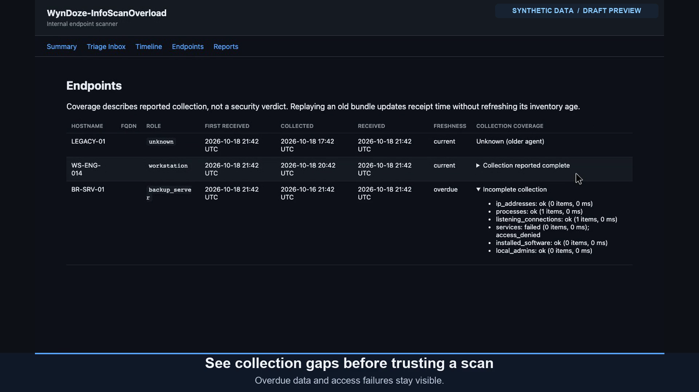
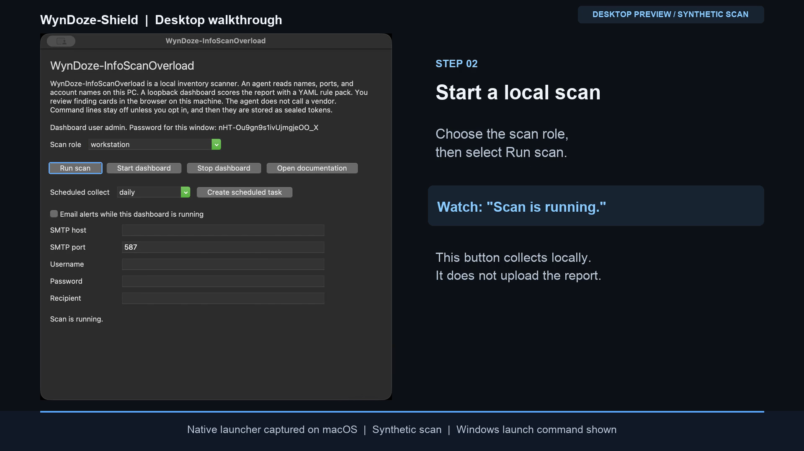

# WynDoze-Shield

A self-hosted agent and dashboard for endpoint inventory. Lightweight agents
collect local telemetry. A loopback server evaluates project-authored heuristics
mapped to MITRE ATT&CK® techniques. An analyst reviews the findings in a triage
inbox. Designed for **Windows 10, Windows 11, and Windows Server 2016, 2019,
2022, and 2025**, with **Python 3.12+**. These are compatibility targets, not a
claim of native acceptance on each OS.

---

## Video demos

Select a preview to open its MP4 recording. Both use synthetic endpoint data.

[](screenshots/demo/wyndoze-shield-30s.mp4)

**[Dashboard walkthrough — 30 seconds](screenshots/demo/wyndoze-shield-30s.mp4).**
Collection health and triage.

[](screenshots/demo/wyndoze-shield-desktop-29s.mp4)

**[Desktop launch, scan, and dashboard — 29 seconds](screenshots/demo/wyndoze-shield-desktop-29s.mp4).**
The native Tk launcher on macOS, a synthetic scan, and the local web dashboard.
The recording predates the copyable password field; the password shown belongs
to a terminated demo session.

---

## What it does

- **Agents** run on each endpoint (backup server, proxy, repository, DC,
  jumpbox, workstation), collect read-only telemetry, and upload it over HTTPS
  with a bearer token — or defer to an **encrypted local bundle** when the
  machine is isolated or the server is unreachable.
- **The server** (FastAPI + SQLite) ingests reports, runs a **declarative YAML
  rules engine** against each one, and records findings. A dark-themed dashboard
  gives you a **Triage Inbox**, a **Timeline**, an **Endpoints** registry, and a
  **Summary** report, plus exports to **CSV / Markdown / JSON / Microsoft
  Sentinel** (NDJSON). Exports always cover every stored finding, regardless of
  dashboard filters.
- **Findings** carry a lifecycle: `triage → flagged / archived / suppressed`.
  Recurring identical evidence on the same host and rule increments an
  occurrence count and preserves the analyst's decision; changed evidence opens
  a separate finding.
- **Collection health** travels with each report: per-collector status, item
  counts, truncation, and safe issue categories. The Endpoints page shows that
  coverage separately from collection age and receipt time, so a successful
  upload is never mistaken for a complete scan.

Dashboard behavior in detail (pagination, filters, decision cards, HTTP status
codes, export sizing) is documented in [user-guide.md](user-guide.md#work-the-inbox)
and [feature.map.md](feature.map.md#server-routes).

### What it deliberately does **not** do

- No file *contents* are ever read — only metadata (names, ports, service
  states, package names, admin account names).
- No credential-store collection. Opt-in command lines can contain secrets;
  retained lines are encrypted, not redacted.
- No active network scanning — only local listening-socket state.
- No telemetry export. Outbound connections are agent uploads to your server
  and, only when configured, SMTP alerts to your chosen mail server.

---

## Security posture

| Concern | Design |
|---|---|
| Agent → server auth | Bearer token (`RECON_INGEST_TOKEN`), constant-time compared. Unset or empty returns 401. |
| Dashboard auth | HTTP Basic (`RECON_DASHBOARD_PASSWORD`). Unset or empty returns 401. Front with SSO/proxy in prod. |
| Dev mode | None. The server logs a warning at startup when a secret is missing; it never opens the endpoint. |
| Bind address | `RECON_HOST` accepts only `127.0.0.1` and `::1`. |
| Transport | HTTPS, or HTTP only to `127.0.0.1` or `::1`. `httpx` ignores proxy env. |
| Data at rest (deferred) | Fernet encrypted bundles. The Windows task stores the key in an ACL'd env file, not Machine environment. |
| Stored XSS | All telemetry HTML-escaped before rendering. |
| Command execution | `subprocess` list-args only, never `shell=True`. Hard timeouts. |
| Rule packs | Pure data via `yaml.safe_load`. Unknown severity fails the pack load. |
| Ingest size | Authenticate first, then reject at the first streamed chunk crossing 8 MiB, before parsing or SQLite writes. |
| Process command lines | Off by default. Opt-in lines require a key and are sealed before storage/upload; patterns inspect at most 800 characters, and encrypted text is limited to 3000 UTF-8 bytes on a character boundary. |
| Kill switch | `RECON_AGENT_DISABLE=1` exits the agent before collection or upload. |

### Responsible use

Use the scanner only on systems you own or are authorized to assess. Inventory
can identify people and machines through usernames, hostnames, addresses, and
executable paths. Enabling command lines can capture embedded credentials in the
encrypted text, which anyone holding the key can recover. Encryption is not
anonymization or redaction.

The SQLite database and plain JSON/CSV/Markdown exports are not encrypted by
the application. Restrict access to them, use appropriate disk protection, and
set your own retention/deletion policy. Do not attach real inventory, keys, or
credentials to public issues. See [SECURITY.md](SECURITY.md) for private reporting.

---

## Install

`pyproject.toml` is the source of truth; `requirements.txt` and
`constraints.txt` repeat its floors and are not a lock. Server installs
require FastAPI 0.143.0 or newer.

```bash
# From the project root, using uv (recommended):
uv venv --python 3.12
source .venv/bin/activate
uv pip install -e ".[server,dev]"     # server + dev tooling
# Agents only need the base install:
uv pip install .
```

```powershell
# Windows, using the minimum supported interpreter:
py -3.12 -m venv .venv
.\.venv\Scripts\Activate.ps1
python -m pip install -e ".[server,dev]"
```

Three console scripts are installed:

- `WynDoze-InfoScanOverload-agent` — the endpoint agent CLI
- `WynDoze-InfoScanOverload-server` — the dashboard server (uvicorn wrapper)
- `WynDoze-InfoScanOverload-desktop` — the Tk desktop launcher (requires Tk and server dependencies)

Startup creates a missing database parent directory privately; existing
directories retain operator-managed permissions. If Windows ACL setup fails,
startup stops before creating the database.

---

## Quick start

**1. Start the server** on loopback. Both secrets are required:

```bash
export RECON_INGEST_TOKEN=devtoken
export RECON_DASHBOARD_PASSWORD=devpassword
WynDoze-InfoScanOverload-server                     # listens on 127.0.0.1:8000
# open http://127.0.0.1:8000/ and sign in as admin
```

**2. Run an agent scan** against it:

```bash
export RECON_AGENT_TOKEN=devtoken           # must match RECON_INGEST_TOKEN
export RECON_AGENT_ENCRYPTION_KEY=$(WynDoze-InfoScanOverload-agent gen-key)
WynDoze-InfoScanOverload-agent scan --server-url http://127.0.0.1:8000/api/scans --role backup_server
```

**3. Work findings** in the Triage Inbox at `/triage`.

### Desktop launcher (Windows desktop with Tk)

Run `.\.venv\Scripts\WynDoze-InfoScanOverload-desktop.exe`. Choose **Start
dashboard**, then **Run scan** to collect a local JSON report. Sign in at
`http://127.0.0.1:8000/` as `admin` with the window's selectable password
(Ctrl+C copies it); the password lives only as long as that window. Neither
the **Run scan** button nor the optional current-user schedule uploads; use the
agent `scan` command above to populate the dashboard. Server Core uses the CLI.
See [the desktop guide](user-guide.md#desktop-launcher) for scheduling and
opt-in mail settings.

### Isolated / air-gapped machines

```bash
# On the isolated host — write an encrypted bundle, no network:
export RECON_AGENT_ENCRYPTION_KEY=$(WynDoze-InfoScanOverload-agent gen-key)   # store this key safely
WynDoze-InfoScanOverload-agent bundle --role repository --cache-dir ./out

# Move ./out/*.WynDoze-InfoScanOverload-bundle to a jumpbox with the same key, then:
export RECON_AGENT_ENCRYPTION_KEY=<same key>
export RECON_AGENT_TOKEN=<server token>
WynDoze-InfoScanOverload-agent replay --server-url https://recon.internal/api/scans --cache-dir ./out
```

Replay deletes a bundle only after HTTP 201 with an `accepted` acknowledgement,
a positive scan ID, and the matching hostname. Redirects and malformed responses
retain the bundle. Corrupt or unreadable bundles are reported individually while
later valid bundles continue. An acknowledged bundle that cannot be deleted (a
file lock, a read-only cache) is also reported, counted as uploaded, and left in
place; it may upload again next time. Any upload or cleanup failure makes replay
exit 1. Each save uses an exclusive filename so rapid scans cannot overwrite one
another. `replay --keep` retains acknowledged bundles too. See
[user-guide.md](user-guide.md#keep-a-bundle-when-upload-fails).

### Evaluate a report locally (no server)

```bash
WynDoze-InfoScanOverload-agent scan --no-upload --output-json report.json --role backup_server
WynDoze-InfoScanOverload-agent evaluate-local report.json          # prints findings as JSON
```

---

## Configuration

All configuration is environment-driven (Pydantic Settings). The full variable
list, defaults, and limits are in [feature.map.md](feature.map.md#agent-environment).

### Agent (`RECON_AGENT_*`)

| Variable | Purpose |
|---|---|
| `RECON_AGENT_TOKEN` | Bearer token presented to the server |
| `RECON_AGENT_ENCRYPTION_KEY` | Fernet key for deferred/isolated bundles and opt-in command lines |
| `RECON_AGENT_DISABLE` | Set to `1` to exit before collection or upload |

### Server (`RECON_*`)

| Variable | Default | Purpose |
|---|---|---|
| `RECON_DB_PATH` | `%ProgramData%\WynDoze-InfoScanOverload\WynDoze-InfoScanOverload.sqlite3` on Windows; `./WynDoze-InfoScanOverload.sqlite3` elsewhere | SQLite database path |
| `RECON_INGEST_TOKEN` | *(unset)* | Required bearer token for `/api/scans` |
| `RECON_DASHBOARD_USER` | `admin` | Basic-auth username |
| `RECON_DASHBOARD_PASSWORD` | *(unset)* | Required basic-auth password. Unset returns 401. |
| `RECON_RULES_PATH` | *(bundled)* | Override rule pack YAML |
| `RECON_HOST` / `RECON_PORT` | `127.0.0.1` / `8000` | Bind address. Only `127.0.0.1` and `::1` are accepted. |
| `RECON_STALE_AFTER_HOURS` | `36` (1–8760) | Age after which an endpoint's last collection is overdue. Future or timezone-less timestamps show unknown freshness. |

---

## Rules engine

Rules are declarative YAML. The source pack (`rules/windows_default.yaml`) and
the bundled copy under `core/rulepacks/` are `windows-default` v1.3 and ship
the same policy across **7 rule kinds**; CI's invariant guard rejects any
drift between the two.

| Kind | Fires when |
|---|---|
| `listening_port` | A listed port is listening locally |
| `process_name` | A process matching a listed name is running |
| `service_present` | A service matching a substring exists (optional state filter) |
| `software_present` | Installed software matches a substring |
| `local_admin_unexpected` | A local admin not on the allow-list is present |
| `missing_expected_service` | An expected service is absent |
| `cmdline_flag` | Legacy `names` use host-level labels; `all_flags`/`any_flags` require labels on one process row |

Every rule may declare `roles:` (scope to endpoint roles), `platforms:`, and
`technique:` (a MITRE ATT&CK id). Process and service presence is a review
hint, not proof of malicious behavior. Recovery utilities and an idle Windows
Update service are low-severity hints; short tunnel software names use
whole-name matching to reduce incidental hits. Windows missing-service checks
require a nonempty service inventory and do not infer absence from partial or
failed service collection.

Windows reports retain administrator display names and add a bounded
`local_admin_sids` mapping. The bundled admin rule accepts account-domain RIDs
500 (built-in Administrator, including renamed/localized accounts) and 512
(Domain Admins), plus its explicit name allowlist. A qualified name alone is
never stripped to a trusted basename. Older reports without SIDs still use
explicit name matches; tune qualified allowlist entries for other approved accounts.

Command lines stay empty unless `--cmdline` is set, and then they are stored as
Fernet tokens. Bounded labels remain on the process row with PID and creation
time. The host union remains for legacy consumers. Use `all_flags` for required
labels and `any_flags` for alternatives; both conditions apply when both are present.
These fields cannot be mixed with legacy `names`. Severity describes review priority,
not confidence of malicious intent. Diagnostic tool presence and bypass/encoding
switches alone are low supporting signals.

Example:

```yaml
name: windows-default
version: "1.3"
rules:
  - id: cmd-credential-dump
    kind: cmdline_flag
    title: Potential sensitive-target dumping operation
    severity: high
    technique: T1003
    all_flags: [dump-operation, sensitive-target]
```

Point the server at a custom pack with `RECON_RULES_PATH=/path/to/pack.yaml`,
or evaluate with `WynDoze-InfoScanOverload-agent evaluate-local report.json --rules pack.yaml`.

Matching covers bounded direct invocations, not arbitrary shell/script semantics.
It does not read script files, decode encoded payloads, or recover commands that
finish between scans. The initial behaviors cover named LSASS targets with supported
ProcDump switches, `ntdsutil` IFM creation, explicit PowerShell `-Command` download
and expression execution, `vssadmin delete shadows` / `wmic shadowcopy delete`,
`wevtutil cl` / `clear-log`, and `reg add` to HKLM/HKCU Run/RunOnce keys (including
Wow6432Node). PID-only dump targets, uncommon ProcDump switches, implicit PowerShell
commands, and other registry-write tools are outside this parser's coverage.
Older agents without per-process labels cannot trigger the new combined rules.
Validate against representative benign Windows reports and
review alerts per endpoint-day plus analyst-confirmed precision before production
promotion; synthetic regression cases do not measure an estate's false-positive rate.

---

## Deployment

See [`deploy/`](deploy/):

- **Linux (systemd):** `deploy/systemd/WynDoze-InfoScanOverload-agent.{service,timer}` — a hardened
  daily one-shot timer. Copy secrets to `/etc/recon/agent.env` (see
  `deploy/agent.env.example`).
- **Windows:** `deploy/windows/Install-ScanneragentTask.ps1` registers a daily
  SYSTEM task named `ScanzAgentDailyScan` when you run it; this tree never
  registers it for you. It accepts `Scanz_AGENT_TOKEN` /
  `Scanz_AGENT_ENCRYPTION_KEY`, falling back to `RECON_AGENT_*`; the aliases
  take precedence when both are set. It writes canonical `RECON_AGENT_*` keys
  into `C:\ProgramData\WynDoze-InfoScanOverload\agent.env` and locks that file
  to SYSTEM and Administrators; ACL failures stop installation. Pass the
  installed agent `.exe` shim as `-PythonExe`. The daily trigger adds up to
  30 minutes of random delay, and the UTF-8 wrapper quotes paths and passes
  the agent exit code to Task Scheduler.

Put the server behind a TLS-terminating reverse proxy in production.

Operator guides: [user-guide.md](user-guide.md) and [feature.map.md](feature.map.md).

---

## Development

```bash
ruff check src tests        # lint (ruff "ALL" ruleset)
ruff format src tests       # format
mypy src                    # strict type check
mypy --platform win32 src   # Windows-only paths
python .agents/skills/invariant-guard/check_invariants.py
# Exercise affected paths locally; hosted CI runs full regression/platform coverage.
```

Hosted CI runs Ruff, strict mypy on both platforms, the invariant guard, wheel
building, Linux coverage, Windows Server 2022/2025 regressions on Python
3.12 through 3.15, and the synthetic task-installer fixture
(`tests/windows/Test-TaskInstaller.ps1`) on both Windows images. Hosted
runners do not establish Windows 10/11 or Server 2016/2019 acceptance.

Project layout:

```
src/wyndoze_infoscanoverload/
├── core/         # domain: models, severity, MITRE catalog, rules engine
│   └── rulepacks/  # bundled YAML rule packs
├── agent/        # collectors, encrypted cache, uploader, Typer CLI
├── server/       # FastAPI app, SQLite storage, HTML templates, exports
├── desktop.py    # Tk launcher and current-user scheduling
└── alerts.py     # opt-in SMTP submission
```

---

## License / status

The project's code is available under the [MIT license](LICENSE), without
warranty. The static ATT&CK catalog includes third-party material covered by
[MITRE's notice and license](NOTICE.md), which also ships in built packages.
Dependencies retain their own licenses.

MITRE ATT&CK® and ATT&CK® are registered trademarks of The MITRE Corporation.
This independently maintained project is not affiliated with or endorsed by
MITRE or any security/backup vendor. Its heuristic findings are leads for human
review, not MITRE-certified detections or proof of compromise.
